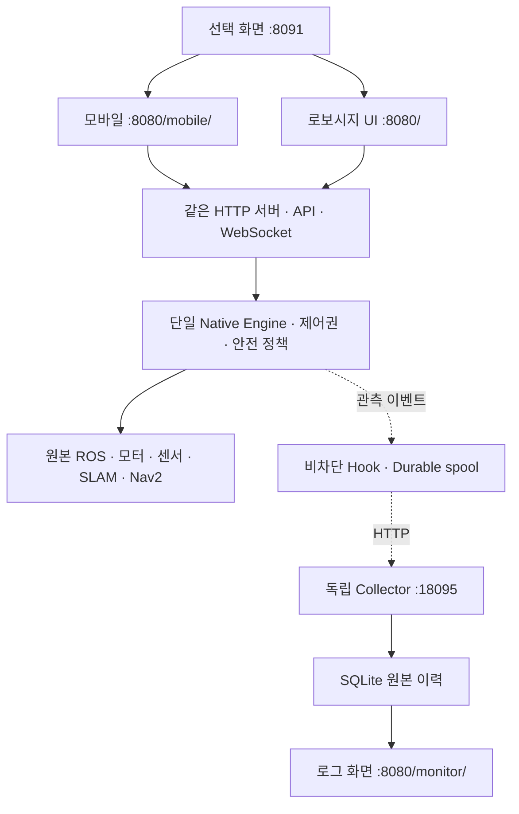

# 하나의 서버·엔진, 두 화면

## 실행 흐름

1. 사용자가 `:8091`에서 화면을 선택합니다.
2. 두 화면은 `:8080`의 `/ws`에 직접 연결하고 원본 Hub에서 client_id를 받습니다.
3. 같은 출처의 POST는 원본 HTTP 검사와 단일 엔진의 제어권·안전 정책을 거칩니다.
4. 연결 종료와 제어권 해제는 원본 Hub가 처리합니다.
5. 엔진 이벤트는 비차단 Hook → spool → Collector → SQLite로 별도 수집됩니다.
